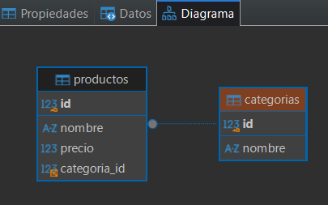
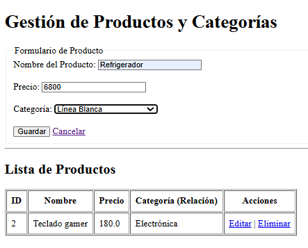
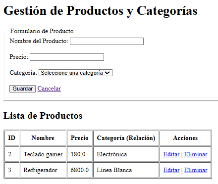
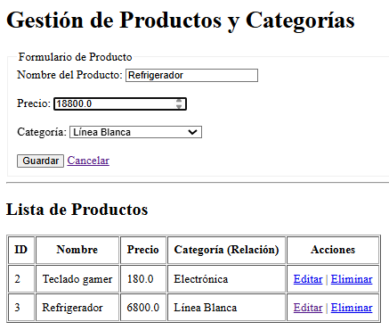
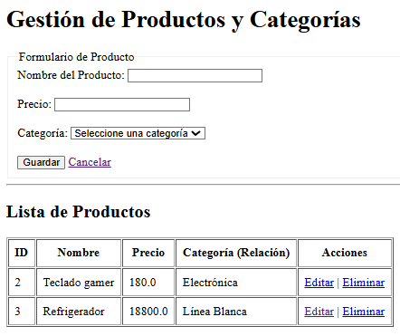
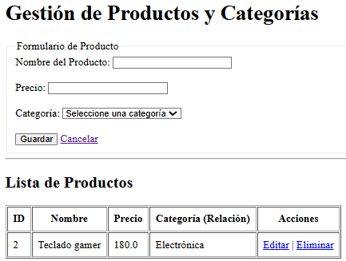

# 🚀 Actividad 3: CRUD en Spring Boot con MySQL y Docker (VPS Deployment)

Aplicación web desarrollada en **Spring Boot** que implementa un modelo **CRUD completo** con relaciones de base de datos (`@OneToMany` / `@ManyToOne` entre Productos y Categorías), persistencia con **MySQL** corriendo en un contenedor de Docker en un servidor VPS, y una interfaz de usuario limpia basada en **Thymeleaf**.

---

## 🛠️ Tecnologías y Stack Tecnológico

* **Backend:** Java 17+, Spring Boot (Web, Data JPA, Thymeleaf)
* **Base de Datos:** MySQL (ejecutándose en contenedor Docker)
* **Gestión de Dependencias:** Maven
* **Despliegue / Servidor:** VPS Linux (Ubuntu), Entorno de producción con Tomcat embebido en puerto `8092`
* **Control de Versiones:** Git y GitHub

---

## ⚙️ Arquitectura y Estructura del Proyecto

El proyecto sigue una arquitectura por capas estándar orientada a servicios:

```text
src/
 └── main/
     ├── java/
     │   └── com/felix/act3_crud/
     │       ├── controller/   # Controladores Web (Thymeleaf endpoints)
     │       ├── model/        # Entidades JPA (Producto y Categoría)
     │       ├── repository/   # Interfaces Spring Data JPA
     │       └── service/      # Lógica de negocio
     └── resources/
         ├── static/           # Archivos estáticos (CSS, JS)
         ├── templates/        # Vistas HTML con Thymeleaf
         └── application.properties # Configuración de conexión e infraestructura

```

## 📸 Evidencias y Capturas de Pantalla

### 1. Modelo en Base de Datos (DBeaver) 

> 

### 2. Operacion: Crear y leer

> 
> 

### 3. Operacion: Editar

> 
> 

### 4. Operacion: Eliminar

> 

